# 02 — Hybrid multi-tenant SaaS: gap analysis and target architecture

> Status: Phase 1 deliverable, **proposal for review — nothing here is
> implemented.** Items marked **[EXISTS]** are verified in the repo
> (see 01-current-architecture-audit.md); **[NEW]** items are proposals;
> **[CHANGE]** modifies something that exists. Open choices are collected
> in 03-risks-decisions-roadmap.md as D-numbers.

## 1. Guiding principles

1. **One codebase, one deployment, row-level tenancy.** The tenant is the
   existing `accounts` row (product term: *workspace*). We extend it; we do
   not introduce a second tenancy mechanism.
2. **The database is the isolation boundary.** Every tenant row carries
   `account_id`; every policy goes through one helper; the UI/API never
   filter on their own as a *substitute* for RLS.
3. **Access is always an explicit grant.** Membership (business users) or
   assignment (agency staff). No role grants blanket cross-tenant reads.
4. **Cross-tenant power is rare, narrow, time-boxed and logged.**
5. **Expand → migrate → contract.** Existing installs keep working at every
   step; each step is shippable and reversible.

## 2. Gap analysis

| Capability | Target | Today | Gap | Size |
|---|---|---|---|---|
| Tenant entity | Workspace with lifecycle state, origin (self-service / agency), plan | `accounts` (id, name, owner) **[EXISTS]** | add status, origin, agency link, timestamps | S |
| Multi-workspace users | A user may belong to N workspaces | 1 account/user **[EXISTS]** | new `account_memberships`; relax owner uniqueness; rework invite redeem; workspace switcher | **L** |
| Tenant roles | Business Admin / Manager / Agent (+ read-only Viewer) | owner/admin/agent/viewer **[EXISTS]** | add `manager`; relabel owner/admin | M |
| Agency layer | Agencies, staff, explicit client assignment | none | new tables, helper, UI, audit | **L** |
| Platform super admin | Operate platform without reading tenant data by default | none | `platform_admins`, admin console, support-access grants | M |
| Isolation guarantees | RLS everywhere + denormalised `account_id` + composite FKs + tests | RLS on all tables; 9 child tables join-scoped; no behavioural tests | backfill, constraints, **cross-tenant test harness** | M |
| Secrets isolation | Admin-only reads; per-tenant key versioning | viewer-readable ciphertext; global key | column privileges/views; `key_version`, envelope keys | M |
| WhatsApp per tenant | N numbers/WABAs per workspace; self-service connect | 1 number/account; paste-token | allow N configs; Embedded Signup (needs Meta Tech-Provider status) | M–L |
| Entitlements & billing | Plans, limits, usage, subscription state | none (only `ai_usage_log`) | plans/subscriptions/usage tables, enforcement points, provider integration | **L** |
| Audit log | Append-only, tenant-visible, includes agency/platform actors | none | new table + writers at ~20 action sites | M |
| Distributed rate limit | Shared store | per-process Map | swap implementation | S |
| Onboarding | Self-service wizard + agency provisioning | auto personal account at signup | wizard, provisioning flow | M |

## 3. Tenant and workspace model

```
Platform (RLB Solutions operates the deployment)
 ├─ Agencies (RLB Solutions is Agency #1; the model is reusable by others)
 │    ├─ agency_members (agency_admin | agency_staff)
 │    └─ client workspaces  ← explicit, revocable link + per-person assignment
 └─ Workspaces (= accounts; the tenant)
      ├─ origin: self_service | agency_managed
      ├─ members (business_admin | manager | agent | viewer)
      └─ all business data keyed by account_id
```

A workspace is **owned by the business**, even when an agency created it.
The agency's access is a *link* the business can see and revoke, never
ownership. (Decision D3 covers who can revoke.)

## 4. Target ER diagram

Legend: tables tagged `NEW` do not exist; `CHG` exist and change; untagged
are existing and unchanged. Only structurally relevant columns are shown.

```mermaid
erDiagram
  AUTH_USERS ||--|| PROFILES : "has"
  PROFILES {
    uuid user_id PK
    uuid active_account_id "CHG was account_id (kept for compat)"
    text full_name
    text email
  }
  AUTH_USERS ||--o{ ACCOUNT_MEMBERSHIPS : "belongs via"
  ACCOUNTS ||--o{ ACCOUNT_MEMBERSHIPS : "has"
  ACCOUNT_MEMBERSHIPS {
    uuid account_id FK "NEW"
    uuid user_id FK
    enum role "owner|admin|manager|agent|viewer"
    text status "active|invited|suspended"
  }
  ACCOUNTS {
    uuid id PK
    text name
    uuid owner_user_id "CHG unique index dropped"
    uuid agency_id FK "NEW nullable"
    text origin "NEW self_service|agency_managed"
    text status "NEW trial|active|past_due|suspended|cancelled"
    text billing_mode "NEW self|agency"
  }
  AGENCIES ||--o{ AGENCY_MEMBERS : "has"
  AGENCIES ||--o{ ACCOUNTS : "manages (optional)"
  AGENCIES {
    uuid id PK "NEW"
    text name
    text status
  }
  AGENCY_MEMBERS {
    uuid agency_id FK "NEW"
    uuid user_id FK
    enum agency_role "agency_admin|agency_staff"
  }
  ACCOUNTS ||--o{ AGENCY_ACCOUNT_LINKS : "consents to"
  AGENCIES ||--o{ AGENCY_ACCOUNT_LINKS : "requests"
  AGENCY_ACCOUNT_LINKS {
    uuid account_id FK "NEW"
    uuid agency_id FK
    text status "pending|active|revoked"
    uuid accepted_by_user_id
    timestamptz revoked_at
  }
  AGENCY_ACCOUNT_LINKS ||--o{ AGENCY_STAFF_ASSIGNMENTS : "scopes"
  AGENCY_STAFF_ASSIGNMENTS {
    uuid account_id FK "NEW"
    uuid user_id FK "agency staff"
    enum access_role "admin|manager|agent|viewer (capped)"
    uuid granted_by
    timestamptz expires_at
    timestamptz revoked_at
  }
  PLATFORM_ADMINS { uuid user_id PK "NEW" }
  SUPPORT_ACCESS_GRANTS {
    uuid account_id FK "NEW"
    uuid platform_admin_id
    text reason
    timestamptz expires_at
    uuid approved_by_user_id
  }
  PLANS ||--o{ SUBSCRIPTIONS : "priced by"
  ACCOUNTS ||--o| SUBSCRIPTIONS : "has"
  PLANS { text id PK "NEW" jsonb limits "seats,contacts,broadcasts..." }
  SUBSCRIPTIONS {
    uuid account_id FK "NEW"
    text plan_id FK
    text status
    text provider_ref "external id, provider TBD"
    timestamptz current_period_end
  }
  ACCOUNTS ||--o{ USAGE_COUNTERS : "metered"
  USAGE_COUNTERS { uuid account_id FK "NEW" text metric date period bigint value }
  ACCOUNTS ||--o{ AUDIT_LOGS : "records"
  AUDIT_LOGS {
    bigint id PK "NEW append-only"
    uuid account_id "nullable for platform events"
    uuid actor_user_id
    text actor_type "user|agency_staff|platform_admin|api_key|system"
    uuid actor_agency_id
    text action
    text target_type
    uuid target_id
    jsonb metadata
  }
  ACCOUNTS ||--o{ WHATSAPP_CONFIG : "connects"
  WHATSAPP_CONFIG {
    uuid account_id FK "CHG UNIQUE(account_id) relaxed to N per account"
    text phone_number_id "unique instance-wide (kept)"
    text access_token "encrypted; CHG admin-only read + key_version"
    int key_version "NEW"
  }
  ACCOUNTS ||--o{ CONTACTS : "owns"
  ACCOUNTS ||--o{ CONVERSATIONS : "owns"
  CONVERSATIONS ||--o{ MESSAGES : "contains"
  MESSAGES { uuid account_id "CHG denormalised + composite FK" }
  ACCOUNTS ||--o{ AUTOMATIONS : "owns"
  ACCOUNTS ||--o{ FLOWS : "owns"
  ACCOUNTS ||--o{ PIPELINES : "owns"
  ACCOUNTS ||--o{ BROADCASTS : "owns"
  ACCOUNTS ||--o{ API_KEYS : "owns"
```



## 5. Tenant isolation strategy (defence in depth)

| Layer | Mechanism | Status |
|---|---|---|
| L1 Database rows | `account_id NOT NULL` on **every** tenant table including the 9 child tables, with **composite FK** `(account_id, parent_id)` → parent so a child can never point at another tenant's parent | **[CHG]** |
| L2 RLS | Every policy calls one helper `has_account_access(account_id, min_role)`; no inline `profiles` subqueries | **[CHG]** (today 121 helper refs + 25 inline) |
| L3 Server authorization | `requireRole` becomes `requireWorkspaceRole(workspaceId, min)`: workspace id comes from the **URL/route**, is verified against memberships/assignments **server-side on every request**; the client's choice is never trusted | **[CHG]** |
| L4 Service-role code | One audited factory `tenantAdmin(accountId)`; direct `createClient(service key)` banned outside an allow-list by a test/lint rule; every query must filter `account_id` | **[NEW]** convention + test |
| L5 Storage | Path prefix `account-<id>/` + policies through the same helper | **[CHG]** |
| L6 Realtime | Rely on RLS for `postgres_changes`; add a test that a user cannot subscribe to another workspace | **[NEW]** test |
| L7 API keys / MCP | Key bound to one account (already true). Agency staff use **one key per client workspace**; no agency-wide key | **[EXISTS]** + rule |
| L8 Secrets | Admin-only column access for WhatsApp/AI/API credentials; versioned keys; envelope encryption later | **[CHG]** |
| L9 Verification | **Cross-tenant test matrix in CI** against a real Postgres: Tenant A, Tenant B, agency staff with/without assignment, revoked, expired, viewer, anon — across every table, RPC and storage path | **[NEW]**, highest priority |
| L10 Monitoring | Audit log + alert on cross-tenant actor activity (agency/platform) | **[NEW]** |

Why row-based RLS fits multi-membership: policies evaluate each row's
`account_id` against the caller's grants. There is **no "current tenant"
session variable** to forget to set or to leak across pooled connections.
The "active workspace" is only a UI/route concept.

## 6. RLS policy strategy

Single helper (replaces `is_account_member`; the old name remains as a thin
wrapper during migration so no policy needs editing in step 1):

```sql
-- PROPOSAL (not implemented)
has_account_access(p_account uuid, p_min account_role_enum default 'viewer')
  = EXISTS membership(user=auth.uid(), account=p_account, status='active', rank(role) >= rank(p_min))
 OR EXISTS agency path:
      link(account=p_account, status='active')
      AND assignment(user=auth.uid(), account=p_account, not revoked, not expired,
                     rank(LEAST(access_role, agency_cap)) >= rank(p_min))
```

Rules:

- **Agency access can never exceed a cap** (default `manager`): agency staff
  cannot reach billing, member management, ownership transfer, workspace
  deletion or credential *reads* unless the business grants `admin` (D4).
- `platform_admins` have **no** RLS bypass on tenant tables. They operate
  through server-side admin routes (service role) that write an audit
  entry; reading tenant business data requires an active
  `support_access_grants` row (D5).
- Settings-class tables keep `min_role = 'admin'`; secret columns become
  admin-only via column privileges / a view (fixes F1, F2).
- Policies are generated/verified from a table list (one source of truth) to
  avoid a forgotten table; the CI matrix iterates the same list.
- `SECURITY DEFINER` helpers keep `SET search_path = public`; execute grants
  restricted; no helper accepts a user id from the caller.

## 7. Role and permission matrix (proposal)

Roles. Platform: `super_admin`. Agency: `agency_admin`, `agency_staff`.
Workspace: `business_admin` (= existing `owner`/`admin`; `owner` remains the
single billing/ownership anchor flag), `manager` **[NEW]**, `agent`
**[EXISTS]**, `viewer` **[EXISTS]**, kept for read-only stakeholders.
Agency roles act in a workspace **only through an assignment** whose role is
capped.

Legend: ✔ allowed · ◐ conditional (note) · ✖ never · — n/a

| Capability | Super Admin | Agency Admin | Agency Staff (assigned) | Business Admin | Manager | Agent | Viewer |
|---|---|---|---|---|---|---|---|
| Create/suspend agencies, plans | ✔ | ✖ | ✖ | ✖ | ✖ | ✖ | ✖ |
| View workspace metadata, status, usage | ✔ | ◐ own clients | ◐ assigned | ✔ own | ✖ | ✖ | ✖ |
| Read workspace business data (contacts, chats) | ◐ support grant only | ◐ only if assigned | ✔ per assignment | ✔ | ✔ | ✔ | ✔ read |
| Manage agency staff, create client workspaces | ✖ | ✔ | ✖ | — | — | — | — |
| Assign staff to a client workspace | ✖ | ✔ (audited) | ✖ | ◐ may approve/revoke | ✖ | ✖ | ✖ |
| Inbox: read/reply/assign conversations | ✖ | ◐ | ✔ agent+ | ✔ | ✔ | ✔ | ✔ read |
| Contacts CRUD, tags, notes | ✖ | ◐ | ✔ agent+ | ✔ | ✔ | ✔ | read |
| Import/export contacts (bulk) | ✖ | ◐ | ◐ manager+ | ✔ | ✔ | ✖ | ✖ |
| Pipelines & deals: use | ✖ | ◐ | ✔ agent+ | ✔ | ✔ | ✔ | read |
| Pipelines: configure stages | ✖ | ◐ | ◐ manager+ | ✔ | ✔ | ✖ | ✖ |
| Automations / flows: build & activate | ✖ | ◐ | ◐ manager+ | ✔ | ✔ | ✖ | ✖ |
| Broadcasts: create & send | ✖ | ◐ | ◐ manager+ | ✔ | ✔ | ✖ | ✖ |
| Templates: submit to Meta | ✖ | ◐ | ◐ manager+ | ✔ | ✔ | ✖ | ✖ |
| Reports / dashboard | ✖ | ◐ | ✔ | ✔ | ✔ | ◐ own | ✔ |
| WhatsApp credentials (connect / view) | ✖ | ✖ | ◐ connect only if workspace grants admin (D4) | ✔ | ✖ | ✖ | ✖ |
| AI settings & BYO key | ✖ | ✖ | ◐ same as above | ✔ | ✖ | ✖ | ✖ |
| API keys, outbound webhooks | ✖ | ✖ | ◐ same | ✔ | ✖ | ✖ | ✖ |
| Invite/remove members, change roles | ✖ | ✖ | ✖ | ✔ | ✖ | ✖ | ✖ |
| Subscription & billing | ✔ platform-level | ◐ if `billing_mode=agency` | ✖ | ✔ if `billing_mode=self` | ✖ | ✖ | ✖ |
| View audit log | ✔ platform | ◐ own staff's actions | ✖ | ✔ (includes agency/platform actors) | ✖ | ✖ | ✖ |
| Transfer ownership / delete workspace | ✖ | ✖ | ✖ | ✔ owner only | ✖ | ✖ | ✖ |
| Break-glass support access | ✔ time-boxed + logged | ✖ | ✖ | approves (D5) | ✖ | ✖ | ✖ |

Existing mapping: today's `canManageMembers`/`canEditSettings`
(`src/lib/auth/roles.ts`) = `business_admin`; `agent`/`viewer` unchanged.
`manager` = new rank between admin and agent (`ALTER TYPE … ADD VALUE`,
which cannot run in the same transaction as its first use — migration must
be split in two files).

## 8. Agency-to-client assignment model

1. **Link (business-level, consent):** `agency_account_links` — created by
   the agency (`pending`) when it provisions or is invited by a workspace;
   becomes `active` when a Business Admin accepts (agency-created
   workspaces are `active` from creation with the client owner recorded as
   pending acceptance). The business can set `revoked` at any time; effect
   is immediate (RLS reads link status live).
2. **Assignment (person-level, least privilege):** `agency_staff_assignments`
   — an Agency Admin grants a specific staff member access to a specific
   workspace with a role (capped), optional `expires_at`, and a reason.
3. **No implicit access:** an Agency Admin does *not* automatically read
   client data; they self-assign (creating an audit entry visible to the
   client) — D2 asks whether to relax this for admins.
4. **Offboarding:** removing an agency member or revoking a link
   invalidates access in the same statement (no cached grants); audit entry
   written; open sessions lose access on next request because every request
   re-checks (L3).
5. **Visibility to the client:** the Members/Access screen lists agency
   staff with access, their role, who granted it, last activity.

## 9. User journeys

### Model B — self-service customer

1. Signup (email + password) → email confirmation **[EXISTS]**.
2. `handle_new_user` creates workspace + `owner` membership **[EXISTS]**;
   proposed: mark `origin=self_service`, `status=trial`.
3. **[NEW] Onboarding wizard:** business name, country/timezone, plan choice
   (or trial) → WhatsApp connect → invite team → import contacts.
4. **[NEW]** Entitlements applied from plan; billing portal link.
5. Invite employees by link with role (`manager`/`agent`/`viewer`)
   **[EXISTS: invite links]**; seat limit enforced **[NEW]**.
6. Owner may later *invite an agency* (creates a `pending` link, accepted by
   the owner) **[NEW]** — the same workspace transitions to hybrid with no
   data move.

### Model A — agency-managed client

1. Agency Admin signs in to the agency console **[NEW]** and creates a client
   workspace (`origin=agency_managed`, `agency_id` set, `billing_mode`
   per D6) with an `active` link.
2. Admin assigns staff (role + optional expiry) **[NEW]**.
3. Staff configure CRM, WhatsApp, automations inside the workspace using the
   workspace switcher **[NEW]**; every action is attributed (`actor_type =
   agency_staff`) in the audit log **[NEW]**.
4. Agency invites the client's Business Admin (invite link, `admin` role,
   **[EXISTS: invitations; CHG: multi-membership]**). Client accepts →
   consent recorded; client sees who from the agency has access.
5. Client may revoke the link; agency loses access immediately; data stays
   with the workspace. Optionally the client converts to self-service
   billing.

## 9b. WhatsApp credential isolation design

- Keep `whatsapp_config` account-scoped **[EXISTS]**; relax
  `UNIQUE(account_id)` to allow multiple numbers per workspace if plans
  require it; keep `UNIQUE(phone_number_id)` instance-wide so webhook
  routing stays unambiguous **[EXISTS]**.
- Credential **reads** admin-only at the database (column privileges or a
  `whatsapp_config_safe` view without token columns for non-admins) —
  closes F1.
- Server decrypts tokens only inside server routes that already resolved
  the workspace; never returned to the browser **[EXISTS: config route
  masks]**; agency staff never receive them unless D4 grants admin.
- **Key management:** add `key_version`; support a key ring in env
  (`ENCRYPTION_KEYS`) with lazy re-encryption (pattern already used for
  CBC→GCM); later envelope encryption (per-workspace DEK wrapped by a
  KMS key) so one leak or one tenant offboarding does not touch all.
- Self-service connect: Meta **Embedded Signup** requires RLB to be a Meta
  Tech Provider (business verification + app review) — external
  dependency, D7. Until then agency-assisted connection or manual token
  paste continues to work.
- Webhook: one URL, HMAC verified against the app-secret list **[EXISTS]**;
  tenant resolved by `phone_number_id`; resolved `account_id` is the only
  tenant key used afterwards **[EXISTS]**.

## 10. Subscription and entitlement design (proposal — no billing provider chosen)

Tables: `plans` (id, name, `limits jsonb`, `features jsonb`, active),
`subscriptions` (account, plan, status, period, provider reference),
`usage_counters` (account, metric, period, value), optional
`plan_overrides` (per-workspace exceptions for agency deals).

Resolution: `get_entitlement(account_id, key)` = override ?? plan limit.
Enforcement is **server-side at the write path** (never UI only):

| Limit | Enforcement point (existing code location) |
|---|---|
| Seats | invitation create/redeem RPCs |
| Contacts | contact create/import, API v1 |
| Broadcast recipients / month | broadcast create (`broadcast-core`) |
| WhatsApp numbers | `whatsapp/config` route |
| Automations / flows active | activate routes |
| AI usage | `ai/*` routes — `ai_usage_log` is the meter **[EXISTS]** |
| API / webhooks access | API key and endpoint create |

States: `trial → active → past_due → suspended → cancelled`. Suspension
policy (read-only vs blocked, grace days, data-retention on cancel) is a
**business decision (D8)** — not assumed. Provider (Stripe, Razorpay, other)
is open (D6); webhooks from the provider must be signature-verified and
idempotent.

## 11. Audit logging design

`audit_logs` (append-only; see ER): no UPDATE/DELETE grants to any role;
inserts only via a SECURITY DEFINER function or service role; monthly
partitions. Business Admins can **read their workspace's rows, including
rows caused by agency or platform actors**; agencies read only rows about
their own staff; super admins read via admin routes.

Actions logged (minimum): sign-in anomalies; membership/role/ownership
changes; agency link and assignment changes; support-access grants and any
break-glass read; WhatsApp config create/update/delete (never the secret);
API key and webhook endpoint create/revoke; AI key changes; bulk
import/export; broadcast send; automation activate/deactivate; billing and
entitlement changes; workspace suspend/delete. Retention is a business
decision (D9) — not assumed.

## 12. Migration and backward-compatibility strategy

Expand → migrate → contract; every existing account stays a working
self-service workspace.

| Step | Change | Back-compat |
|---|---|---|
| 0 | Cross-tenant **test harness** against current schema (no schema change) | baseline of today's guarantees |
| 1 | Secrets exposure fix (F1/F2) — column privileges/views | app routes already mask; verify |
| 2 | Add `account_memberships`; **backfill from `profiles`**; keep `profiles.account_id/role` and a trigger keeping both in sync | old code keeps working |
| 3 | Introduce `has_account_access`; make `is_account_member` call it (dual-read, results asserted equal in tests); migrate 25 inline `profiles` policies | zero policy text edits in 121 sites |
| 4 | Denormalise `account_id` onto 9 child tables (backfill → NOT NULL → composite FKs) | transparent |
| 5 | App: workspace-in-route context + switcher; replace `profile.account_id` reads (112 files / ~680 refs; mechanical via `requireWorkspaceRole`) | single-workspace users see no change |
| 6 | Relax `idx_accounts_one_per_owner`; rework `redeem_invitation` to **add** a membership (no deletion); update `handle_new_user` | invite UX unchanged for single users |
| 7 | Audit log + writers; agency tables, helper branch, console | new surface only |
| 8 | Plans/subscriptions/usage + enforcement | default plan = unlimited for existing accounts |
| 9 | Contract: `profiles.account_id` → `active_account_id`; drop legacy `profiles.role`; remove dual-read | after a release of stability |

Flags: reuse the `beta_features` pattern for gradual rollout. Every step
ships with a down/rollback note and a matrix-test addition. Existing
migration numbering (gaps at 050 and 056) is left alone; new files continue
from 061.
