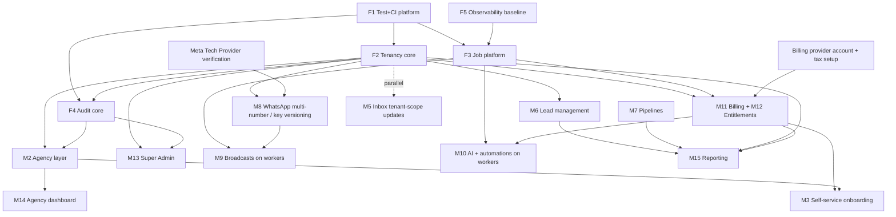

# 04 — Master implementation plan and infrastructure strategy

> Status: Phase 1 deliverable, **proposal for review — nothing implemented.**
> Supersedes the phase table in [03](./03-risks-decisions-roadmap.md) §3
> (03's decisions D1–D14 and risks R1–R12 remain valid). Built on the
> audit in [01](./01-current-architecture-audit.md) and target in
> [02](./02-hybrid-saas-target-architecture.md).
> No calendar dates are given: durations depend on team size, which is
> unknown. Sizes are relative effort (S < M < L < XL).

## 1. Strategy in one page

- **One complete product, one master plan, one launch.** All modules in the
  brief are in scope; none is dropped to keep things small.
- **Build order ≠ release stages.** Work is sequenced in internal *waves*
  by technical dependency and merged continuously to a **staging**
  environment behind feature flags. Production launches when the launch
  gate (§9) passes. There is no throw-away MVP, so no redesign between
  stages.
- **Honest risk of this strategy:** a single big launch concentrates risk
  (late integration, late discovery of billing/Meta issues). Mitigation
  built into the plan: staging runs the *whole* product from Wave A on,
  every wave ends with an integrated demo and the full test suite, and
  Meta/billing external dependencies (§6) are started on day one because
  their lead time is outside our control.
- **Architecture is frozen except by ADR.** §7 lists frozen decisions;
  changing one needs an Architecture Decision Record **and your approval**.
- **Infrastructure follows measurement.** Design for scale now; provision
  the smallest sound footprint; scale on measured triggers (§8).

## 2. Scope: the brief mapped to modules

Status key: **E** exists · **E+** exists, needs tenant/entitlement/agency
work · **N** new.

| # | Module | Status | Evidence / gap |
|---|---|---|---|
| M1 | Multi-tenant core (workspaces, memberships, roles, isolation) | E+ | accounts + RLS exist; single-membership, no agency (doc 01) |
| M2 | Agency management (agencies, links, assignments, console) | N | none exists |
| M3 | Self-service onboarding | E+ | signup auto-creates a workspace; no wizard/plan/trial |
| M4 | Authentication & RBAC | E+ | Supabase Auth + 4 roles; add `manager`, MFA for privileged roles, route-level workspace authz |
| M5 | Shared inbox | E | inbox, assignment, quick replies, media, voice |
| M6 | Contacts & **lead management** | E+/N | contacts, tags, custom fields, CSV import exist; **no lead concept** (no source/status/score/lifecycle/capture) — new fields + views |
| M7 | Sales pipelines | E | Kanban + deals |
| M8 | WhatsApp Business integration | E+ | Cloud API, webhook, templates; add multi-number, per-WABA pacing, Embedded Signup, key versioning |
| M9 | Broadcasts & messaging | E+ | works but runs inside web requests; needs worker + pacing |
| M10 | AI chatbot & automation | E+ | BYO-key AI, knowledge base, auto-reply, automations, flows; add worker execution, entitlements, cost metering |
| M11 | Subscription & billing | N | none |
| M12 | Usage limits & entitlements | N | only `ai_usage_log` metering exists |
| M13 | Super Admin dashboard | N | none |
| M14 | Agency dashboard | N | none |
| M15 | Tenant reporting | E+ | one dashboard overview (volume, response time, pipeline value); add per-module reports, exports, date ranges |
| M16 | Security, audit logs, monitoring | E+/N | headers, HMAC, encryption exist; **no audit log, no metrics/alerts, no health endpoint**, CSP report-only |
| M17 | Background job platform | N | today `after()` inside requests (webhook 60 s, resume 300 s) + external cron pings |
| M18 | Backup & recovery | N (ops) | none documented |
| M19 | Deployment & environments | E+ | Dockerfile/compose exist; no staging/prod pipeline |
| M20 | Branding, legal, i18n | E+ | Phase 1 started; logo/assets/legal pending owner input |

## 3. Dependency analysis

### 3.1 Foundational (everything else waits on these)

| Foundation | Why it is foundational |
|---|---|
| **F1 Test & CI platform** — real-Postgres **cross-tenant test matrix**, environment pipeline, ADR process | Every later schema change is verified by it; building it later means unverified isolation |
| **F2 Tenancy core (M1 core)** — `account_memberships`, `has_account_access`, `account_id` on 9 child tables + composite FKs, `manager` role, workspace-in-route authz | Agency, billing, onboarding, reporting, audit all key off workspace access |
| **F3 Job platform (M17)** — Postgres-backed queue + separate worker | Broadcast, AI, automations, usage metering, billing sync and cron all run on it; also what makes web and worker scale independently |
| **F4 Audit log core (M16)** — table + writer API | Cross-tenant (agency/platform) access must never exist unlogged |
| **F5 Observability baseline** — structured logs, request ids, health endpoints, error tracking, basic metrics | Needed to *measure* before scaling (the strategy depends on it) |

### 3.2 Dependency graph



### 3.3 What can be developed independently (in parallel, with a small team split)

| Independent of tenancy work (start immediately) | Needs F2 first | Needs F2 + F3/F4 |
|---|---|---|
| F1 test platform (against **current** schema) | M2 agency layer | M9 broadcasts on workers |
| F5 observability baseline | M13 Super Admin | M10 AI/automation on workers |
| F3 queue + worker **skeleton** (account_id already exists on engine tables) | M11/M12 schema + enforcement | M3 onboarding |
| M20 branding, legal pages, i18n review | M6 lead fields (small, can share a migration) | M14 agency dashboard |
| M19 container/CI/staging environment | M8 multi-number | M15 reporting v2 |
| Credential-visibility fix (F1/F2 in doc 01) | M5/M7 tenant-scope touch-ups | |
| Security items: CSP enforce, `middleware→proxy`, MCP install | | |

## 4. Build waves (internal sequencing, one launch)

Each wave ends with: lint, typecheck, unit tests, **cross-tenant matrix**,
build, deploy to staging, integrated walkthrough. **No wave changes
frozen decisions (§7) without an ADR.**

### Wave A — Foundations (size: L–XL)
- F1: test harness (Postgres via Supabase CLI as in `migrations.yml`),
  matrix over every table/RPC/storage path; CI to staging.
- F5: logging with request/tenant ids and PII redaction, `/api/health/live`
  + `/ready`, error tracking, metric counters.
- F3: `jobs` table (queue, lease, attempts, backoff, dead-letter, per-account
  and per-WABA concurrency keys) + worker entrypoint from the **same
  codebase/image**; first migrated jobs: cron endpoints (automations,
  flows, wait-for-reply expiry).
- F2: memberships + helper + child-table `account_id` + `manager` +
  credential-read fix; dual-read with equality tests; workspace-in-route
  authz and switcher; invitation/redeem rework.
- F4: `audit_logs` + writer; instrument existing sensitive actions.
- M20: final identity assets and legal inputs collected in parallel.

### Wave B — Platform capabilities (L–XL, parallel streams)
- M2/M14 agency layer and dashboard; M13 Super Admin console (incl.
  support-access grants).
- M11/M12 plans, subscriptions, usage counters, enforcement points,
  provider integration with signed, idempotent webhooks.
- M8 multi-number, per-WABA pacing/backoff, key versioning, Meta API
  version constant.
- M9/M10 move broadcast delivery, webhook-side processing (automations,
  flows, AI auto-reply, outbound webhooks) to jobs; the HTTP webhook only
  verifies, persists the raw event and enqueues (fast ack to Meta).
- M6 lead management (source, status/lifecycle, owner, score, capture
  forms/API, views).

### Wave C — Product completion (M–L)
- M3 self-service wizard and agency provisioning flow; trials.
- M15 reporting v2 (per-module reports, exports, scheduled summaries).
- M16: audit UI, alerting, CSP enforcement, distributed rate limiting,
  MFA for platform/agency admins.
- M5/M7 final multi-tenant polish; M4 permission matrix UI.
- Embedded Signup (if Tech Provider approved).

### Wave D — Production readiness (M)
Load/soak test on a representative dataset; restore drill; pen test and
fixes; runbooks; capacity baseline; legal pages finalised and published;
launch gate (§9).

## 5. Security requirements (cross-cutting, each tied to a verification)

| Requirement | Verified by |
|---|---|
| No cross-tenant read/write for any role, table, RPC, storage path, realtime channel, API key, MCP key | CI matrix (F1) — blocking |
| Agency access only via active link + live assignment; expiry/revocation immediate | matrix cases + audit assertions |
| Platform admins have no RLS bypass; reads of tenant data need a grant | matrix + code review rule |
| Service-role client only via `tenantAdmin()` allow-list | lint/test rule |
| Secrets never logged or returned; admin-only column reads; versioned keys | tests + log-redaction tests |
| Webhook (Meta, billing provider) signatures verified, replay-safe, idempotent | unit + replay tests |
| Per-tenant and per-IP rate limits on shared store | load test |
| MFA for super admin and agency admin | Supabase Auth config (verify plan support) |
| CSP enforced (nonce-based), existing headers kept | header tests |
| Dependency and secret scanning in CI; audit gate on prod deps | CI |
| Threat model (STRIDE) per module reviewed before the module merges | review checklist |
| Independent penetration test before launch | Wave D |

## 6. External dependencies with outside lead time (start immediately)

| Dependency | Needed by | Owner | Notes |
|---|---|---|---|
| Meta business verification / Tech Provider status (Embedded Signup) | M8, M3 | RLB | outside our control; manual token connect remains as fallback |
| Billing provider account, tax/invoicing setup | M11 | RLB | provider choice D6 |
| Production domain, DNS, email sender domain (SPF/DKIM) | auth emails, invites | RLB | Supabase SMTP or provider TBD |
| Legal entity details, counsel review | legal pages | RLB | checklist in `docs/legal/` |
| Hosting account(s) and Supabase organisation | staging/prod | RLB | D11/D12 |

## 7. Frozen architecture decisions (change only by ADR + your approval)

| # | Decision |
|---|---|
| A1 | Row-based multi-tenancy; the tenant is the `accounts` row (workspace); `account_id` on every tenant table |
| A2 | Postgres (Supabase) is the single system of record; RLS via one helper (`has_account_access`) |
| A3 | One Next.js application codebase + one **worker** process built from the same codebase and image |
| A4 | Background work runs through a **Postgres-backed job queue** (`SKIP LOCKED` leases); no new message broker at launch |
| A5 | Web tier stateless; session in cookies; files in object storage; shared state only in Postgres (or a shared store added by ADR) |
| A6 | Agency access = consent link + per-person capped assignment; no implicit cross-tenant roles |
| A7 | Platform admins have no RLS bypass; support access via logged, time-boxed grants |
| A8 | Entitlements enforced server-side at write paths from a single `get_entitlement` source |
| A9 | Audit log append-only, written for every cross-tenant and sensitive action |
| A10 | No Kubernetes, no microservices; modular monolith + worker |
| A11 | Expand → migrate → contract for every schema change; applied migrations are never edited |

Process: ADRs live in `docs/architecture/adr/NNNN-title.md` (context,
options, decision, consequences, rollback). A proposed change is posted to
you before any code is written.

## 8. Infrastructure strategy: design for scale, provision on evidence

### 8.1 Why the current code is close to ready

Verified in the repo: Next.js `output: "standalone"` Docker image; auth in
cookies; files in Supabase Storage; realtime delegated to Supabase — the
web tier is nearly stateless already. Three things are **not**:

| Statefulness / coupling today | Fix (in plan) |
|---|---|
| Heavy work in `after()` inside web requests (webhook 60 s, broadcast resume 300 s, API broadcasts, outbound webhooks) — bound to function timeout and to the web process | F3 job queue + worker |
| In-memory rate limiter (`src/lib/rate-limit.ts`) and an in-memory AI status cache | shared-store rate limiter (Postgres-based first; Redis only if measured contention, via ADR); cache TTL accepted or moved to DB |
| Scheduling by **external pingers** hitting cron URLs with a shared secret | worker-internal scheduler (leader via DB lease) |

Already a good base: a **database-level delivery lease** for broadcasts
(`broadcast-delivery-lease.ts`) shows the pattern the worker generalises.

### 8.2 Target runtime topology (no Kubernetes)

```
Users ─► TLS reverse proxy / CDN ─► web (N× identical container)  ─┐
Meta/Billing webhooks ─► web (verify, persist, enqueue, 200 fast)  │
                                                                   ├─► Supabase Postgres (+Auth, Storage, Realtime)
                         worker (M× identical container) ◄─ jobs ──┘
                         (broadcasts, automations, flows, AI,
                          outbound webhooks, usage rollups,
                          billing sync, scheduled tasks)
Backups: Supabase backups + our own logical dumps to separate object storage
Observability: logs + metrics + error tracking + external uptime check
```

Web and worker are the **same image with different commands**, so each is
scaled independently by changing a replica count or host size — no code
change.

### 8.3 Starting footprint ("Tier 0")

- 1 web container + 1 worker container on **one modest host** (VPS or
  PaaS — hosting choice is D11), TLS reverse proxy.
- 1 production Supabase project on a paid tier suitable for production
  (not a free/pausable tier); **a separate staging project**.
- Object storage = Supabase Storage; separate bucket/account for logical
  backups.
- External uptime monitor; error tracking; log retention at host level.
- No Redis, no broker, no replicas, no CDN beyond the reverse proxy.

Specific CPU/RAM/plan sizes are not stated here because they cannot be
justified without your expected load (D15) — Wave D's load test sets the
initial numbers.

### 8.4 Scale ladder and triggers

Metrics are collected from Wave A (F5). Thresholds are **starting
proposals** to tune after the first load test, not measured facts.

| Signal | Starting trigger (sustained) | Action | Code change? |
|---|---|---|---|
| Web CPU / memory | >70% CPU or >80% RAM for 15 min | Larger host, or add web replica | none (stateless) |
| p95 API latency | above target (set in Wave D) | profile first; then replica / DB index | none or index only |
| Queue lag (oldest runnable job age) | > target for message-class jobs (e.g. >30 s) | add worker replica / host | none |
| Worker CPU/memory | >70% | resize / replicate worker independently of web | none |
| DB CPU, connections, slow queries | >70% CPU, >80% connection use | enable pooling mode, tune queries, upgrade compute | pooling config |
| DB storage growth | projected full < 30 days | upgrade storage; archive/partition `messages`, `audit_logs` | partitioning migration (planned) |
| Reporting queries slowing OLTP | dashboards affect p95 | read replica or pre-aggregated rollups | reporting reads via replica-aware client |
| Rate-limit store contention / multi-web | 2+ web instances | shared limiter (already shared if Postgres-based) | none if planned in F3 |
| Single huge tenant | noisy neighbour in queue/DB | per-tenant job concurrency caps; as last resort a dedicated project for that tenant (ADR) | routing only |
| Meta throughput | send errors 130429/80007 etc. | per-WABA pacing (built in M8/M9) | none |

What we deliberately do **not** buy early: Kubernetes, a message broker,
multi-region, read replicas, a CDN tier, dedicated Redis, enterprise DB
tiers.

### 8.5 Backup and recovery (M18)

- Enable the managed database backups available on the chosen Supabase
  tier **and verify** retention and point-in-time-recovery availability for
  that tier (not assumed here).
- Independent nightly logical dump (schema + data) to separate storage,
  encrypted; also covers Storage bucket objects.
- Define **RPO/RTO** targets with you (D16); rehearse a restore into a
  scratch project quarterly and before launch; document the runbook.
- Secrets (`ENCRYPTION_KEY(S)`, service key, Meta secrets) escrowed in a
  password manager/secret store with a documented recovery owner —
  losing the encryption key orphans all stored tokens (doc 01 §4).
- Migrations are the source of truth for schema; staging mirrors
  production schema at all times.

### 8.6 Monitoring (M16/F5)

Structured JSON logs (request id, workspace id, actor type, no secrets or
message bodies); metrics: request rate/latency/error, queue depth and lag,
job failures/dead letters, Meta send success/throttle rates, webhook
ack latency, AI call latency/cost, DB health, per-tenant usage; alerts:
webhook failing, queue lag, dead-letter growth, error rate, storage,
certificate expiry, backup failure. Choosing a hosted error/metrics
vendor adds a sub-processor — it must be reflected in the privacy draft.

## 9. Testing and deployment readiness

**Test layers:** unit (existing vitest, 1728 passing); **DB behavioural
tests** on a real Postgres (the matrix, RPC auth, storage, realtime);
API contract tests for `/api/v1`; job-platform tests (lease expiry,
retry, dead-letter, duplicate delivery safety, kill-worker-mid-job);
billing webhook replay tests; browser end-to-end tests for critical
journeys (would add a test-runner dependency — needs your approval);
load/soak tests with synthetic tenants; security tests (dependency/secret
scan, header tests, authz fuzz on every route with each role).

**Environments:** local (Supabase CLI), staging (own Supabase project,
Meta test numbers, billing test mode), production. Config via environment
variables only; secrets never in git.

**Delivery:** GitHub Actions build → image → deploy to staging
automatically, production by manual approval; migrations applied by CLI
before the app rollout under expand/contract so the previous app version
keeps working; feature flags (`platform_settings`/per-workspace) for
unfinished modules; one-command rollback of app image; DB rollback by
forward-fix migration plus restore point.

**Launch gate (all required):** matrix green incl. agency/platform cases;
pen-test criticals/highs closed; restore drill passed; load test meets
targets with headroom; alerts firing in a fire-drill; legal pages
approved by counsel and entity details filled; billing live-mode test
transaction; runbooks written; rollback rehearsed.

## 10. Module workstream sizing (relative)

| Workstream | Size | Parallelisable after |
|---|---|---|
| F1 test/CI platform | L | now |
| F5 observability | M | now |
| F3 job platform + migration of 5 background paths | XL | F1 |
| F2 tenancy core | XL | F1 |
| F4 audit log + instrumentation | M | F2 |
| M2 + M14 agency layer & dashboard | XL | F2, F4 |
| M13 Super Admin | L | F2, F4 |
| M11 + M12 billing & entitlements | XL | F2, F3 |
| M8 WhatsApp multi-number/pacing/keys/Embedded Signup | L–XL | F2 (Embedded Signup: external) |
| M9/M10 on workers | L | F3, M8 |
| M6 lead management | M | F2 |
| M15 reporting v2 | L | M6, M11 |
| M3 onboarding wizard + provisioning | L | M2, M11 |
| M16 hardening (CSP, rate limit, MFA, alerts) | M–L | F5, F3 |
| M18/M19 backup, environments, CI/CD | M | now |
| M20 branding/legal/i18n | M | owner inputs |

## 11. Unresolved decisions added by this strategy

| ID | Decision | Recommendation |
|---|---|---|
| D15 | Expected scale assumptions: tenants, workspaces/agency, messages/day, largest broadcast, peak concurrency, growth | Provide rough numbers; Wave D load tests use them; no sizing is guessed in this plan |
| D16 | RPO/RTO and backup retention requirements | Set with you before Wave D; drives backup tier and drill frequency |
| D17 | Job queue on Postgres (A4) vs adding Redis/managed queue now | Postgres first; Redis only via ADR when measured contention appears |
| D18 | Error tracking/metrics vendor (hosted vs self-hosted) | Hosted for speed; update privacy draft sub-processors |
| D19 | Approve a browser E2E test runner as a new dev dependency | Yes, dev-only |
| D20 | Staging environment budget (second Supabase project, host) | Yes — required to test the complete product safely |
| D21 | Team size/availability (determines parallel streams and calendar) | Needed to turn sizes into dates |

## 12. What Phase 1 still requires from you before sign-off

1. Approve or amend the target architecture (doc 02) and frozen decisions (§7).
2. Answer D1–D14 (doc 03) and D15–D21 above — at minimum D2–D6, D11, D15.
3. Provide legal/branding inputs (`docs/legal/legal-information-checklist.md`).
4. Say whether to commit the Phase 1 working tree.

Phase 2 (Wave A start) does not begin until you approve.
